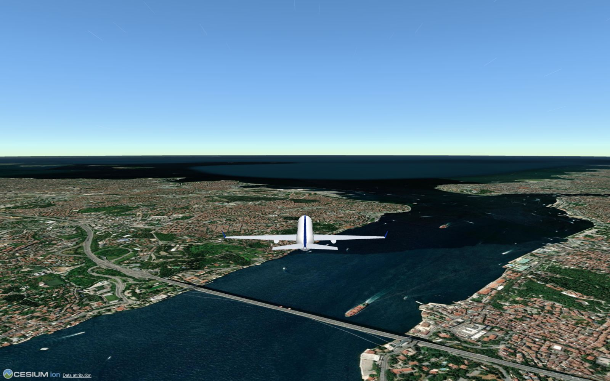

# SkyRoam ✈

**A browser flight game over the real world.** Pick one of 101 real aircraft, pick any town on Earth or a world-famous historic site, and fly. No install, no account, no server: a static site with a website and the game.

**Gerçek dünya haritası üzerinde tarayıcıda uçuş oyunu.** 101 gerçek uçaktan birini seç, dünyadaki herhangi bir yeri ya da ünlü bir tarihi alanı seç ve uç. Kurulum yok, hesap yok, sunucu yok: bir web sitesi ve oyundan oluşan statik bir site.

| | |
|---|---|
| **Website / Web sitesi** | <https://smyrna-pergamum.github.io/skyroam/> |
| **▶ Play / Oyna** | <https://smyrna-pergamum.github.io/skyroam/play.html> |



## Website / Web sitesi

The website (`index.html`) is an experimental, scroll-driven film: one evening flight from Istanbul over the Sea of Marmara, the Dardanelles and Troy to Pergamon, on the live map. It opens with a gate that loads the planet and lets you enter with sound. As you scroll, the plane flies along a golden trail, the sun sets, city lights come on and, in one chapter, the aircraft changes from the 1903 Wright Flyer to the A380. At the end you type any town and the game opens, already flying from there. Sound, Reduce motion and Clear view are in the strip at the bottom.

Web sitesi (`index.html`) deneysel, kaydırmayla ilerleyen bir film: canlı harita üzerinde İstanbul’dan Marmara, Çanakkale Boğazı ve Truva üzerinden Bergama’ya tek bir akşam uçuşu. Gezegeni yükleyen ve sesle girmeni sağlayan bir kapıyla açılır. Kaydırdıkça uçak altın rengi bir iz boyunca uçar, güneş batar, şehir ışıkları yanar ve bir bölümde uçak 1903 Wright Flyer’dan A380’e dönüşür. Sonunda herhangi bir yer adı yazarsın; oyun oradan uçarak açılır. Ses, hareketi azaltma ve sade görünüm alttaki şeritte.

The design is also published as a reusable AI design skill: [live-globe-flight-film](https://github.com/smyrna-pergamum/web-design-skills/tree/main/skills/live-globe-flight-film) in [web-design-skills](https://smyrna-pergamum.github.io/web-design-skills/).

Tasarım, yeniden kullanılabilir bir yapay zekâ tasarım becerisi olarak da yayımlandı: [web-design-skills](https://smyrna-pergamum.github.io/web-design-skills/) içinde [live-globe-flight-film](https://github.com/smyrna-pergamum/web-design-skills/tree/main/skills/live-globe-flight-film).

## Launch links / Başlatma bağlantıları

Any page can open the game at a place and in an aircraft. / Herhangi bir sayfa oyunu bir yerde ve bir uçakla açabilir.

```
play.html?fly=1&lat=41.04&lon=29.02&name=Istanbul&ac=a320neo&hdg=20&alt=700&cam=cockpit&lang=tr&tod=night
```

| param | meaning |
|---|---|
| `lat`, `lon`, `name` | where to start (decimal degrees, a label) |
| `ac` | aircraft id from `js/fleet.js`, e.g. `cessna-172`, `concorde`, `f-16c` |
| `hdg`, `alt` | heading in degrees, altitude in metres |
| `cam` | `chase`, `cockpit` or `nose` |
| `lang` | `tr` or `en` |
| `tod` | time of day: `auto` (real local time at the place), `sunrise`, `day`, `dusk` or `night` |
| `tspeed` | how fast time runs: `1` (real), `60` (1 min = 1 hour) or `600` (1 min = 10 hours) |
| `wx` | weather: `live`, `clear`, `cloudy`, `overcast`, `rain`, `snow`, `storm` or `fog` |
| `wind`, `wdir` | wind set by hand: speed in km/h (0–200) and the direction it blows from in degrees |
| `mode` | `free`, `rings`, `takeoff` or `landing` |
| `ap`, `rwy` | start at an airport (ICAO or IATA code, e.g. `LTFM` or `IST`) on a runway (e.g. `35L`); without `rwy` the longest runway is used |
| `fly=1` | skip the menu and take off at once (without it, the menu opens with these choices selected) |

Values are checked and only change where you start; the address bar is cleaned after loading.

---

## Features / Özellikler

- **Real world** via [CesiumJS](https://cesium.com/platform/cesiumjs/): satellite imagery, real terrain and 3D buildings
- **101 real-world aircraft** in four groups (commercial 27, civil 24, military 26, historic 24): A320neo, 737 MAX, 777, 787, A380, Concorde, Cessna 172, Cirrus SR22, ASK 21 glider, F-16, F-35, Eurofighter, KAAN, Hürjet, Hürkuş, Bayraktar TB2, Akıncı, B-2, C-130J, Wright Flyer, Fokker Dr.I, Spitfire, P-51, DC-3, Vecihi K-VI, Nu.D.36 and many more
  - Each model is generated from the type's real dimensions and layout: smooth lofted fuselage, tapered and swept wings, T-tails, twin tails, canards, deltas, biplanes and triplanes, engine nacelles and propellers, canopies, cabin windows, winglets and livery
  - Each flight model comes from the type's real top and stall speeds and handling class (supersonic speeds are compressed so the map can keep up)
  - Search by name, maker, country or year, and filter by group
  - Optional: drop a `.glb` model into the project and point an aircraft's `model` field at it
- **Retractable landing gear**: folds up after take-off and comes down automatically near the ground (or press `G`). Landing with the gear up counts as a crash.
- **Hangar**: modify any aircraft (engine power, wingspan, agility, three colours), name it and save it. Changes show live on the plane and in its stats.
- **Take off anywhere**:
  - Continent → country → city lists (all 81 provinces of Türkiye plus resort towns, 190+ cities in 86 other countries)
  - 46 world-famous historic sites and landmarks (Giza, Petra, Machu Picchu, Ephesus, Pergamon, Göbekli Tepe, Hagia Sophia, Colosseum…)
  - 22 natural wonders (Cappadocia, Everest, Matterhorn, Grand Canyon, Fjords…)
  - **Search** for any city, town or village, or take off from your own location
  - **Coordinates**: type or paste latitude/longitude (decimal or 41°00′29″N), with optional heading and altitude
  - **Airports**: 1,100+ large airports worldwide and every Turkish airport with scheduled flights, with their real runways ([OurAirports](https://ourairports.com/data/) data, bundled, searched offline by city, name or code). With no search typed, the airports nearest the chosen city are listed. You start at the runway threshold with the engine idle; pick the runway in the menu.
- **Free flight** and a timed **ring course** (best times saved per place and aircraft)
- **Take-off and landing missions** at real airports (with a city chosen, its nearest airport is used):
  - Take-off: from the threshold, stay on the centreline, rotate and climb to 120 m; scored on time and centreline deviation
  - Landing: start 9 km out on a 3° glide path; the HUD shows distance, glide path and centreline deviation, and PAPI lights beside the runway turn white and red like the real ones. Touch down on the runway, then brake to a stop: scored out of 100 for a soft touchdown, the aim point and the centreline
  - Runway edge, threshold and end lights for night landings
  - **Kalkış ve iniş görevleri**: gerçek havalimanlarında. Kalkışta merkez hattında kalıp 120 m'ye tırman; inişte 9 km uzaktan 3° süzülüş yolunda gel, PAPI ışıklarıyla yolu koru, piste yumuşak in ve dur. Puan teker koyma hızına, hedef noktaya ve merkez hattına göre verilir.
- Arcade flight model: stalls, coordinated turns, landing and crashing, fixed 120 Hz physics
- **Cockpit interior** with live instruments, different per aircraft class, modelled on real cockpits:
  - analog six-pack, avionics stack (COM/NAV, GPS, transponder), engine gauges, switch row, throttle and mixture knobs and a moving yoke (light props)
  - airliner glass cockpit seen from the captain's seat: overhead panel, glareshield with autopilot panel, PFD with mode annunciator and speed trend, ND with wind, engine display (N1/EGT, or torque/prop rpm for turboprops), thrust levers that move with the throttle, and two moving yokes
  - fighter: HUD on a combiner glass with flight path marker, up-front control with data display, two MFDs with option buttons, standby gauges, side stick and throttle
  - the static parts are drawn once and cached, so the detailed cockpits cost no frame rate
  - **Rain and snow on the windscreen**: drops bead on the glass and the airstream pushes them up and out at speed; snowflakes stick and melt; flying through cloud mists the glass
  - minimal panel with variometer and a yaw string (glider)
- Three cameras: chase, cockpit interior, nose
- **Speed you can feel**: the field of view widens with speed and kicks when you open the throttle, the chase camera falls back while accelerating, and there are speed lines and a light buffet at high speed, on the ground roll and in a stall. "Reduce camera motion" in the menu turns these off.
- **Minimap** (bottom right): a heading-up OpenStreetMap with a compass ring, coordinates and the name of the place below you. Press `N` to toggle it.
- **Touch controls** for phones and tablets: the left thumb works a floating stick, the right thumb has the throttle lever, rudder, brake, gear and camera buttons. Landscape works best.
- **On-screen throttle lever**: drag it with mouse or finger, or use the mouse wheel over it
- Keyboard, gamepad and touch
- Recorded engine, turbine, wind, crash and landing-gear sounds (from Pixabay) layered over a small synthesiser
- **Cockpit warnings** modelled on real aircraft: stall horn (light aircraft) or stick shaker (jets), overspeed clacker, and GPWS-style voice callouts (PULL UP, SINK RATE, TOO LOW GEAR, BANK ANGLE, STALL) plus radio-altitude callouts on landing (100 … 10 ft) in glass-cockpit aircraft. The voice uses the browser's speech synthesis; the tones are synthesised. You can switch the warnings off in the menu.
- **Day and night**: the real sun lights the world at the real local time of wherever you fly, and the HUD shows that local time. Or start at sunrise, day, sunset or night (menu, or `T` in flight), and let time run at real speed, 1 min = 1 hour or 1 min = 10 hours to watch the sun set and rise. At night the sky turns black with stars and the moon, and cities light up: NASA's Black Marble glow from high up, and street-level points of light near the ground, made in the browser from the satellite tiles (built-up areas and roads glow, water, forest and fields stay dark).
  - **Gece ve gündüz**: gerçek güneş, uçtuğun yerin gerçek yerel saatine göre dünyayı aydınlatır; yerel saat ekranda görünür. Ya da gün doğumu, gündüz, gün batımı veya gece ile başla (menü ya da uçarken `T`) ve zamanı gerçek hızda, 1 dk = 1 saat ya da 1 dk = 10 saat hızında akıt. Gece gökyüzü yıldızlarla kararır, şehirlerin ışıkları yanar.
- **Live weather** from [Open-Meteo](https://open-meteo.com/) (free, no key): cumulus clouds around you from the real cloud cover, haze from visibility, rain or snow on the screen, lightning in thunderstorms. When the sky is fully covered there is a real **cloud deck**: a grey ceiling from below, white-out inside, and a sunlit sea of cloud tops when you climb through it. **Wind**: the real wind at your height (from the 10 m and 180 m winds, stronger higher up) drifts the aircraft, gusts and storms bring turbulence, light aircraft feel it far more than airliners, and on the runway the nose weathervanes into a crosswind. The HUD shows the weather, the local time and an arrow with where the wind blows relative to your nose.
- **Pick the weather yourself**: clear, partly cloudy, overcast, rain, snow, thunderstorm or fog, and set the **wind by hand** (speed and the direction it blows from) on top of any weather.
  - **Havayı kendin seç**: açık, parçalı bulutlu, kapalı, yağmur, kar, fırtına ya da sis; rüzgârın hızını ve yönünü elle ayarla.
  - **Canlı hava durumu**: gerçek bulut örtüsünden bulutlar, görüş mesafesinden pus, yağmur ya da kar, fırtınada şimşek. Gökyüzü tamamen kapalıysa bulut tabakasının içinden geçip güneşli bulut denizinin üstüne çıkabilirsin. Bulunduğun yükseklikteki gerçek rüzgâr uçağı sürükler, hamle ve fırtına türbülans yapar, hafif uçaklar daha çok etkilenir; ekrandaki ok rüzgârın burnuna göre yönünü gösterir.
- Turkish and English UI

## Map modes and your Cesium ion token

On first launch the game shows a short **Cesium setup screen** with the warnings below. You can paste a token or **skip** and play in Lite mode.

The game **never ships with a token**. Each player adds their own free one:

| Mode | What you get | Needs |
|---|---|---|
| **Lite** | Satellite imagery on a flat globe | Nothing |
| **3D** | Real terrain (mountains, valleys) + OSM 3D buildings | Free Cesium ion token |
| **3D photorealistic** (experimental) | Google Photorealistic 3D Tiles | Cesium ion token with access to that asset |

How to get a token:

1. Create a free account at [ion.cesium.com](https://ion.cesium.com/signup).
2. **Access Tokens → Create token**, tick only the **`assets:read`** scope. Don't use your Default Token.
3. Optionally restrict it to your site under **Allowed URLs**.
4. Paste it on the welcome screen, or later under **Settings**.

The token is stored only in the player's browser (`localStorage`, or `sessionStorage` if "remember" is off) and is only sent to Cesium's servers. Treat it like a password: don't share it or show it in screenshots.

## Privacy

- City search sends only the typed place name to the [Open-Meteo geocoding API](https://open-meteo.com/en/docs/geocoding-api).
- "Take off from where I am" uses the browser's location permission; the position stays in the browser.
- The minimap loads map tiles from tile.openstreetmap.org. About every 20 seconds, and only after you have moved a few kilometres, it sends your rounded position to [Nominatim](https://nominatim.org/) to show the place name. This follows the [OSM tile](https://operations.osmfoundation.org/policies/tiles/) and [Nominatim](https://operations.osmfoundation.org/policies/nominatim/) usage policies.
- Live weather sends the aircraft's position rounded to about 1 km to the [Open-Meteo forecast API](https://open-meteo.com/en/docs) when you take off, then again every 15 minutes or after 40 km. Pick any other weather to send nothing.
- At night the game loads Esri satellite tiles a second time to draw street lights, and NASA GIBS night tiles.
- Settings, custom aircraft and best times are kept in `localStorage`. There is no server and no tracking.
- The website loads map tiles from Esri and NASA GIBS, its font from Google Fonts, and sends a typed town name to Open-Meteo only when you press Take off. It has no analytics; your language choice is kept in `localStorage`.

## Controls / Kontroller

| Action | Keyboard | Gamepad |
|---|---|---|
| Nose down / up | `W` `S` / `↑` `↓` | Left stick Y |
| Bank left / right | `A` `D` / `←` `→` | Left stick X |
| Rudder | `Q` `E` | LB / RB |
| Throttle | `R` `F` / `+` `−` / drag the on-screen lever | RT / LT |
| Air brake / wheel brake | `Space` | B |
| Camera (chase / cockpit / nose) | `C` | A |
| Pause / menu | `P` / `Esc` | Start |
| Sound | `M` | Y |
| Landing gear (manual override) | `G` | |
| Minimap | `N` | |
| Time of day (local / sunrise / day / sunset / night) | `T` | |
| Restart after crash | `Enter` | A |

Keys are read by physical position, so WASD works on AZERTY and other layouts too.

**Landing tip:** keep vertical speed above about −5 m/s (−4 for airliners), wings within ±15°, and touch down below the aircraft's landing speed.

## Run locally

ES modules need an HTTP server (opening the files directly will not work):

```bash
python -m http.server 8000
```

Then open <http://localhost:8000> for the site, or <http://localhost:8000/play.html> for the game.

## Deploy to GitHub Pages

**Settings → Pages → Deploy from branch → `main` / root**. There is no build step.

## Project structure

```
index.html        website: scroll-driven evening flight Istanbul to Pergamon, then take off from any town
site/world.js     the website's flight: route, camera, dusk, aircraft swaps, sound, town search
site/world.css    website styles (site/tokens.css, site/base.css underneath)
.hallmark/        design log of the website (Hallmark skill)
play.html         the game: welcome screen, menu (flight / aircraft / settings), HUD
style.css         game UI and HUD styles
js/main.js        viewer, map modes, game loop, camera, HUD, launch links
js/sky.js         day and night: sun lighting, time of day, stars, city and street lights
js/weather.js     weather (live from Open-Meteo or picked): clouds, overcast deck, haze, rain, snow, wind, turbulence
js/airports.js    airport list loader, search, nearest airports, runway geometry
js/missions.js    take-off and landing missions, runway and PAPI lights
js/menu.js        menu tabs, place picker + search + coordinates, aircraft grid, hangar, welcome
js/cockpit.js     cockpit interiors on a canvas overlay (GA, glass, fighter, glider), rain on the windscreen
js/fleet.js       101 real aircraft: dimensions, wing/tail/engine layout, speeds, livery
js/fleetgen.js    turns a fleet entry into a 3D model (lofted meshes) and a flight model
js/aircraft.js    roster, mods (hangar), old-id aliases
js/warnings.js    cockpit warnings: stall horn / shaker, clacker, GPWS voice callouts
js/feel.js        speed feel: dynamic FOV, camera lag, shake, speed lines
js/minimap.js     OpenStreetMap minimap with compass
js/touch.js       two-thumb touch controls
js/places.js      continents / countries / cities, historic sites, natural wonders
js/flight.js      fixed-step (120 Hz) arcade flight model
js/plane.js       builds an aircraft's parts into one Cesium primitive
js/input.js       keyboard + gamepad actions, radial deadzone
js/rings.js       ring course generation and pass detection
js/audio.js       WebAudio: recorded loops + synthesiser, chime, crash, gear
js/storage.js     safe localStorage helpers, token storage
js/i18n.js        Turkish / English strings
sounds/           Pixabay sound effects (see credits)
data/airports.json  airports and runways (OurAirports, public domain), loaded only when needed
models/           optional .glb models that replace the generated one (Hürjet)
site/img/         screenshot from the game (website fallback and preview image)
```

Adding an aircraft: add an entry to `FLEET` in `js/fleet.js`. The model and the flight model are generated from it. To use a real 3D model instead, put a `.glb` in `models/` (metres, glTF +Y up, nose +Z) and add `model: { url: 'models/name.glb' }` to the entry; the generated model shows until it has loaded. Adding a place: add a row to `js/places.js`.

## Roadmap ideas

- Tilt steering for phones
- Collision with 3D buildings
- Taxiways, ATC and approach lighting systems
- Daily route challenge, multiplayer ghosts

## Credits and data terms

- [CesiumJS](https://github.com/CesiumGS/cesium) (Apache-2.0), loaded from jsDelivr
- 3D mode: Cesium World Terrain, Bing Maps imagery and Cesium OSM Buildings via Cesium ion (© OpenStreetMap contributors)
- Lite mode: Esri World Imagery tiles (© Esri, Maxar, Earthstar Geographics). Check [Esri's terms](https://www.esri.com/en-us/legal/terms/full-master-agreement) before heavy or commercial use.
- City search: [Open-Meteo Geocoding API](https://open-meteo.com/) (data from GeoNames, CC BY 4.0)
- Weather: [Open-Meteo Forecast API](https://open-meteo.com/) (CC BY 4.0)
- Airports and runways: [OurAirports](https://ourairports.com/data/) (public domain)
- City lights (game and website): [NASA Black Marble](https://earthobservatory.nasa.gov/features/NightLights) via NASA GIBS (public domain)
- Minimap: map tiles and place names © [OpenStreetMap contributors](https://www.openstreetmap.org/copyright) (ODbL), via tile.openstreetmap.org and Nominatim
- Aircraft models are generated in code from public dimensions for this project. They are simplified likenesses, not official models. The Hürjet `.glb` was built for SkyRoam in Blender from public views and dimensions; it is an approximation, not TUSAŞ's CAD model. Aircraft names are their makers' trademarks and are used only to identify the types.
- Sounds from [Pixabay](https://pixabay.com/sound-effects/) under the [Pixabay Content License](https://pixabay.com/service/license-summary/):
  - `prop.mp3`: "Propeller.wav" by freesound_community
  - `jet.mp3`: "Jet Engine" by freesound_community
  - `turbine.mp3`: "Airplane Turbine Engine Loop" by Audley_Fergine
  - `wind.mp3`: "Wind Loop" by freesound_community
  - `crash.mp3`: "Boom Crash" by DRAGON-STUDIO
  - `gear.mp3`: "Cockpit Sound of Landing Gear Deployment" by arunangshubanerjee
- Website font: [Archivo](https://fonts.google.com/specimen/Archivo) via Google Fonts (SIL Open Font License)
- Attributions are shown in the in-game credit bar and on the website, and must stay visible.
